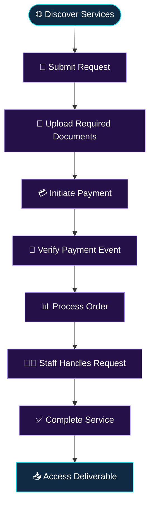
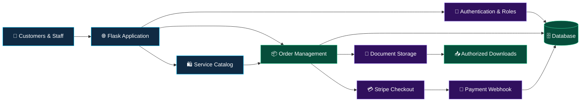
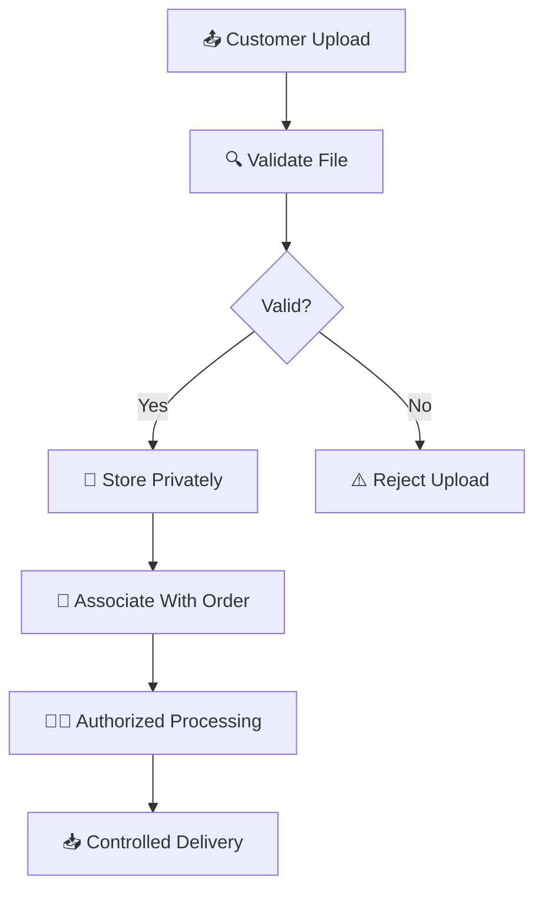

<div align="center">
  
</div>

# 🌐 JOHN ONLINE SERVICES & APPLICATIONS

<div align="center">

<!-- ANIMATION 01: PREMIUM ANIMATED HEADER -->


<!-- ANIMATION 02: TYPING INTRODUCTION -->


<!-- ANIMATION 03: TECHNOLOGY DIVIDER -->


### 🚀 YOUR DIGITAL WORLD, SIMPLIFIED

**Discover. Request. Upload. Pay. Track. Complete.**

*Connecting people with digital services through technology, automation, and innovation.*

[✨ Features](#-02-features--capabilities) • [⚙️ Technology](#-04-technology-stack) • [🏗️ Architecture](#-05-system-architecture) • [🚀 Installation](#-09-installation-guide) • [🔐 Security](#-08-security-first)

[](https://github.com/johncharlessarwi-dot)
[](https://www.python.org/)
[](https://flask.palletsprojects.com/)
[](#-14-license)

</div>

---

<!-- ANIMATION 04: CODING GIF -->
<div align="center">


</div>

# 🌌 01. About the Project

**JOHN ONLINE SERVICES & APPLICATIONS** is a Flask-powered digital service marketplace designed to make online services more accessible, convenient, and organized.

The platform brings together service discovery, customer requests, document management, payment workflows, order tracking, and administrative operations within one structured digital environment.

The project focuses on creating a practical service-delivery experience in which customers can explore available services, submit requests, provide required documents, initiate supported payments, follow progress, and access completed deliverables through appropriate workflows.

The system also provides a role-based foundation for administrative management, service operations, accounting, and customer access.

### 🎯 Our Mission

To simplify digital service delivery by bringing customer requests, documents, payments, and service progress into one organized platform.

### 🌍 Our Vision

To build accessible, reliable, and scalable digital solutions that help individuals, students, entrepreneurs, and businesses interact with online services more efficiently.

### 💡 Core Principles

- **Accessibility:** Make digital services easier to discover and request.
- **Efficiency:** Reduce unnecessary manual steps through organized workflows.
- **Transparency:** Provide structured order references and status management.
- **Security:** Protect customer information and restrict access to authorized users.
- **Scalability:** Maintain an architecture that can evolve as operational needs grow.
- **Innovation:** Explore practical applications of software engineering and automation.

<div align="center">

<!-- ANIMATION 05: MISSION TYPING BANNER -->


</div>

---

# ✨ 02. Features & Capabilities

The project is organized around a collection of service-delivery capabilities. Actual availability depends on the routes, templates, models, configuration, and integrations implemented in the repository.

<table>
<tr>
<td width="50%" valign="top">

### 🛍️ Digital Marketplace


- Organized service catalog
- Customer service requests
- Order creation and references
- Structured service workflows
- Service information and descriptions
- Foundation for service discovery

</td>
<td width="50%" valign="top">

### 📂 Document Management


- Customer document uploads
- Local file storage support
- Order-related document handling
- Completed-work downloads
- Document-to-order association
- Foundation for controlled file access

</td>
</tr>
<tr>
<td width="50%" valign="top">

### 💳 Online Payments


- Stripe Checkout integration points
- Payment webhook endpoint
- Configurable checkout minimum
- Payment event processing
- Order-payment association
- Foundation for reconciliation workflows

</td>
<td width="50%" valign="top">

### 📊 Order Management


- Order status workflows
- Service progress management
- Staff service operations
- Customer order access
- Structured order references
- Foundation for completion tracking

</td>
</tr>
<tr>
<td width="50%" valign="top">

### 👥 Role-Based Access

- `super_admin`
- `admin`
- `service_officer`
- `accountant`
- `customer`

Permissions should be enforced on the server, not only by hiding interface elements.

</td>
<td width="50%" valign="top">

### 🗄️ Database & Forms

- Flask-SQLAlchemy
- Flask-Migrate
- Flask-WTF
- Jinja2 templates
- SQLite development database
- Structured validation workflows

</td>
</tr>
</table>

### 🧩 Additional Design Considerations

| Area | Objective |
|---|---|
| Customer experience | Clear service discovery and request flows |
| Administration | Centralized operational management |
| Payments | Server-verified payment processing |
| Documents | Controlled uploads and downloads |
| Data management | Consistent relationships between records |
| Error handling | Helpful validation and failure messages |
| Maintainability | Modular, readable application structure |
| Localization | Consideration for Tanzanian users and services |

<div align="center">

<!-- ANIMATION 06: NEON DIVIDER -->


</div>

---

# 🧭 03. How the Platform Works

A typical customer journey can follow the workflow below, depending on which capabilities are enabled in the deployed application.



<div align="center">

<!-- ANIMATION 07: WORKFLOW TYPING -->


</div>

### Workflow Explanation

1. **Discover:** Customers review available digital services.
2. **Request:** A customer submits the information required for a service.
3. **Upload:** Supporting documents are provided where necessary.
4. **Pay:** The customer initiates an available payment workflow.
5. **Verify:** The server validates payment events before updating payment state.
6. **Process:** An authorized staff member handles the request.
7. **Complete:** The service is marked complete through the appropriate workflow.
8. **Deliver:** The customer accesses the result through an authorized route.

> **Important:** A workflow diagram describes the intended process; it does not independently prove that every step is fully implemented or production-ready.

---

# 🧰 04. Technology Stack

<div align="center">

<!-- ANIMATION 08: TECHNOLOGY ICONS -->


</div>

| Technology | Purpose |
|---|---|
| Python 3.12+ | Core programming language |
| Flask | Web application framework |
| Flask-SQLAlchemy | Database models and ORM |
| Flask-Migrate | Database schema migrations |
| Flask-Login | User session management |
| Flask-WTF | Form handling and CSRF integration |
| Jinja2 | Server-rendered HTML templates |
| HTML5 | Page structure and content |
| CSS3 | Layout and visual styling |
| Tailwind CSS CDN | Utility-first styling where configured |
| Alpine.js | Lightweight frontend interactions where configured |
| Stripe | Checkout and payment webhooks |
| SQLite | Local development database |
| Local file storage | Uploaded document storage |
| Git | Source control |
| GitHub | Repository hosting and collaboration |

### 🐍 Backend

Flask provides a lightweight application framework for routing, request handling, application configuration, and integration with database and authentication extensions.

### 🎨 Frontend

Jinja2 templates provide server-rendered pages, while HTML, CSS, and any configured JavaScript libraries support the user interface.

### 🗄️ Data Layer

Flask-SQLAlchemy provides an ORM interface for application data. Flask-Migrate supports controlled schema evolution through migrations.

### 💳 Payment Layer

Stripe Checkout and webhook integration points support an external payment workflow. Production readiness depends on valid credentials, correct currency configuration, signature verification, and tested event handling.

---

# 🏗️ 05. System Architecture

The following diagram describes a logical architecture for the application.



### Architecture Components

| Component | Responsibility |
|---|---|
| Application routes | Receive and process HTTP requests |
| Authentication | Identify signed-in users |
| Authorization | Enforce role and resource permissions |
| Service catalog | Present available service information |
| Order management | Coordinate requests and service status |
| Database | Persist application records |
| File storage | Store customer documents and deliverables |
| Payment integration | Initiate checkout and process verified events |
| Templates | Render server-generated pages |
| Configuration | Manage environment-specific settings |

### Architectural Priorities

- Separate request handling from business logic where practical.
- Validate user input at the server boundary.
- Maintain consistent relationships between users, orders, files, and payments.
- Keep sensitive credentials outside the source repository.
- Make failures observable through structured logging.
- Use migrations to manage schema changes.
- Avoid trusting client-submitted payment status or prices.
- Restrict access to private resources at every relevant endpoint.

---

# 💳 06. Stripe Payment Integration

The project documentation identifies the following payment endpoints:

```http
POST /orders/<order_number>/stripe-checkout
POST /stripe/webhook
```

These paths must match the actual route definitions in the repository before they are used by a live integration.

### 🇹🇿 Tanzania Shilling Configuration

Example configuration:

```env
STRIPE_MIN_TZS=1500
```

The intended behavior is to reject checkout attempts below the configured minimum and provide a helpful validation message.

### Payment Processing Principles

**1. Server-side amount validation**

The backend should calculate or retrieve the authoritative order amount rather than trusting a value submitted by the browser.

**2. Webhook signature verification**

Verify incoming Stripe webhook signatures using the endpoint secret and the original request payload.

**3. Idempotent event processing**

Repeated delivery of the same event must not create duplicate payments, duplicate fulfillment, or inconsistent order state.

**4. Order-payment consistency**

Persist the relationship between the order and its verified payment information.

**5. Payment reconciliation**

Provide a controlled process to investigate differences between local order records and payment-provider events.

**6. Error handling**

Handle failed checkout sessions, expired sessions, invalid events, network problems, and unexpected provider responses safely.

### Example Environment Variables

```env
STRIPE_SECRET_KEY=sk_test_replace_me
STRIPE_WEBHOOK_SECRET=whsec_replace_me
STRIPE_MIN_TZS=1500
```

Never publish actual secret keys, webhook secrets, or production credentials.

> **Tanzania payment note:** Confirm current Stripe account eligibility, supported settlement arrangements, currencies, and payment methods before enabling live payments. Do not assume that a TZS configuration alone establishes support for TZS transactions.

---

# 🔐 07. Authentication & Authorization

<div align="center">

<!-- ANIMATION 09: SECURITY GIF -->


</div>

### Suggested Role Responsibilities

| Role | Intended responsibility |
|---|---|
| `super_admin` | Highest-level system administration |
| `admin` | Authorized operational administration |
| `service_officer` | Service request processing |
| `accountant` | Authorized financial operations |
| `customer` | Access to personal requests and permitted services |

These are proposed responsibility boundaries. Actual permissions must be verified against the application's authorization code.

### Security Principles

- Hash passwords using an established password-hashing implementation.
- Enforce role permissions on the server.
- Protect state-changing forms against CSRF.
- Use secure, HTTP-only session cookies and appropriate SameSite settings.
- Require HTTPS in production.
- Add rate limits to login and sensitive endpoints.
- Prevent users from accessing another customer's orders.
- Validate file size, type, content, and storage location.
- Keep private files outside publicly served static directories.
- Authorize each private document download.
- Verify payment-provider webhook signatures.
- Make payment event processing idempotent.
- Keep dependencies updated.
- Record important administrative actions in audit logs.
- Back up critical data and test restoration procedures.

### Security Is a Process

A list of recommended controls is not a security certification. Before production deployment, test authentication, access control, file uploads, payment events, session handling, and database recovery.

---

# 📂 08. Document Management

Document management is an important part of a service marketplace because customers may need to submit supporting materials and receive completed deliverables.

### Recommended Document Lifecycle



### File Handling Recommendations

- Apply a strict upload size limit.
- Use an allowlist of permitted file extensions and MIME types.
- Validate file signatures where appropriate.
- Generate safe server-side storage names.
- Avoid trusting the original filename.
- Store uploads outside the public web root.
- Prevent path traversal.
- Restrict file access to authorized users.
- Consider malware scanning for higher-risk deployments.
- Apply retention and deletion rules appropriate to the service.
- Avoid placing sensitive customer documents in application logs.

### Privacy by Design

Collect only the documents needed for a service. Explain why information is needed, restrict staff access, and define appropriate retention and deletion practices.

---

# 🚀 09. Installation Guide

Follow these instructions as a starting point for a local development environment. Commands that depend on custom Flask CLI commands or repository-specific configuration must be checked against the actual codebase.

### Prerequisites

- Python 3.12 or a compatible supported version
- Git
- A terminal such as PowerShell
- Stripe test credentials if testing payment integration
- The project's dependency and environment configuration files

### Step 1 — Clone the Repository

Replace `REPOSITORY-NAME` with the actual repository name.

```powershell
git clone https://github.com/johncharlessarwi-dot/REPOSITORY-NAME.git
cd REPOSITORY-NAME
```

### Step 2 — Create a Virtual Environment

```powershell
python -m venv .venv
```

Activate it in Windows PowerShell:

```powershell
.\.venv\Scripts\Activate.ps1
```

If activation is blocked by your system's execution policy, follow your organization's approved PowerShell configuration guidance.

### Step 3 — Install Dependencies

If the repository contains `requirements.txt`:

```powershell
python -m pip install --upgrade pip
pip install -r requirements.txt
```

If the repository uses a different dependency manager, follow its existing project instructions instead.

### Step 4 — Configure Environment Variables

If `.env.example` exists:

```powershell
Copy-Item .env.example .env
```

Example configuration:

```env
SECRET_KEY=replace-with-a-long-random-secret
DATABASE_URL=sqlite:///app.db
STRIPE_SECRET_KEY=sk_test_replace_me
STRIPE_WEBHOOK_SECRET=whsec_replace_me
STRIPE_MIN_TZS=1500
```

Use the exact variable names expected by the application. This example is not a guarantee that every variable is currently read by the code.

**Never commit your real `.env` file or credentials to GitHub.**

### Step 5 — Configure the Database

For a new project using Flask-Migrate without an existing migrations directory:

```powershell
flask db init
flask db migrate -m "Initial schema"
flask db upgrade
```

For an existing project with migrations, do not run `flask db init` again. Review migration files and apply the appropriate upgrades.

### Step 6 — Seed Initial Data

If the project defines a `seed-data` Flask CLI command:

```powershell
flask seed-data
```

Otherwise, use the initialization process documented by the repository. Do not assume this custom command exists.

### Step 7 — Create an Administrator

If a `create-admin` command is implemented:

```powershell
flask create-admin --help
```

Follow the command's actual arguments to create the first administrator securely. Do not assume the example command or argument names exist without checking the code.

Use a unique password and avoid exposing credentials in shell history.

### Step 8 — Start the Development Server

```powershell
flask run
```

If the application uses an application factory or a custom Flask entry point, configure `FLASK_APP` according to the project structure.

Open the local address printed by Flask, commonly:

http://127.0.0.1:5000

### Step 9 — Verify the Installation

Check the following:

- The home page loads.
- Login and logout behave as expected.
- Unauthorized routes reject access.
- Forms validate input correctly.
- Database operations succeed.
- Upload restrictions work.
- Private documents cannot be downloaded by unauthorized users.
- Payment test events are verified correctly.
- Errors are logged without exposing secrets.

---

# 🎨 10. Visual Experience & User Interface

<div align="center">

<!-- ANIMATION 10: FUTURISTIC BANNER -->


<!-- ANIMATION 11: DESIGN PRINCIPLES -->


</div>

### Design Priorities

- 🌌 Modern and uncluttered layouts
- 📱 Responsive behavior across screen sizes
- ⚡ Clear and efficient customer workflows
- 🔒 Privacy-conscious document handling
- 🧩 Maintainable application architecture
- 🇹🇿 Digital service delivery with Tanzanian users in mind
- ♿ Readable typography and accessible contrast
- 🧭 Consistent navigation and understandable actions
- 💬 Helpful form validation and error messages

### Suggested Visual Identity

| Element | Direction |
|---|---|
| Primary palette | Dark blue and black |
| Accent colors | Cyan, purple, and gold |
| Layout | Clean, responsive, and modular |
| Typography | Readable body text with distinctive headings |
| Motion | Lightweight GIFs and animated SVG banners |
| Brand voice | Professional, practical, and innovation-focused |

Animation should enhance the README rather than interfere with reading. Use descriptive alternative text, and keep the most important project information available even when external image services are unavailable.

---

# 🗺️ 11. Development Roadmap

The roadmap below identifies possible improvements. Items are not claims that every feature is already implemented.

### Phase 1 — Core Reliability

- [ ] Review all application routes and database models.
- [ ] Validate the complete customer order lifecycle.
- [ ] Test authentication and role enforcement.
- [ ] Review database migrations.
- [ ] Standardize validation and error handling.
- [ ] Add automated tests for critical workflows.

### Phase 2 — Customer Experience

- [ ] Enhanced customer dashboard.
- [ ] Detailed order timeline.
- [ ] Clearer order reference and tracking pages.
- [ ] Improved mobile navigation.
- [ ] Better document upload feedback.
- [ ] Customer notification preferences.
- [ ] English and Swahili language support.

### Phase 3 — Operations

- [ ] Advanced administrative analytics.
- [ ] Staff assignment workflows.
- [ ] Administrative audit trails.
- [ ] Automated payment reconciliation.
- [ ] Expanded financial reports.
- [ ] Service performance reporting.
- [ ] Customer feedback and ratings.

### Phase 4 — Production Readiness

- [ ] Private cloud document storage.
- [ ] Tested automated backups.
- [ ] Rate limiting and security monitoring.
- [ ] Continuous integration and deployment.
- [ ] Production deployment automation.
- [ ] Error tracking and operational alerts.
- [ ] Performance testing under expected workloads.
- [ ] Disaster recovery documentation.

### Phase 5 — Future Opportunities

- [ ] Email and SMS notifications.
- [ ] Additional supported payment workflows.
- [ ] Service-specific customer forms.
- [ ] Improved reporting and export capabilities.
- [ ] API integration opportunities.
- [ ] Accessibility improvements.
- [ ] Better service discovery and search.

---

# 🧪 12. Testing & Quality Assurance

A reliable service marketplace needs tests for normal usage, invalid input, permissions, and unexpected failures.

### Recommended Test Categories

| Category | Examples |
|---|---|
| Unit tests | Individual functions and validation logic |
| Route tests | Expected HTTP responses |
| Authentication | Login, logout, and session expiry |
| Authorization | Role restrictions and resource ownership |
| Database | Relationships, constraints, and migrations |
| File uploads | Invalid formats, excessive sizes, and unsafe filenames |
| Payments | Invalid signatures and duplicate webhook events |
| Integration | Order creation and associated payment records |
| Regression | Previously fixed issues remain fixed |
| Deployment | Environment configuration and startup checks |

### Example Test Plan

- [ ] Anonymous users cannot access protected administrative pages.
- [ ] Customers cannot read other customers' private orders.
- [ ] Invalid forms return clear validation messages.
- [ ] Unauthorized downloads are rejected.
- [ ] Payment amounts are validated on the server.
- [ ] Invalid webhook signatures are rejected.
- [ ] Repeated payment events do not duplicate processing.
- [ ] Database migrations work on a clean test database.
- [ ] Secrets are not included in application responses or logs.
- [ ] Critical workflows are tested before production releases.

The exact test commands depend on the repository's test framework and configuration.

---

# 📈 13. Performance, Reliability & Maintainability

### Performance Considerations

- Use database indexes for frequently queried fields where justified.
- Avoid unnecessary repeated database queries.
- Paginate large lists of orders and service records.
- Set reasonable request and upload limits.
- Optimize images and static assets.
- Use production-appropriate server configuration.
- Monitor slow requests and database operations.
- Test expected concurrent usage rather than relying on assumptions.

### Reliability Considerations

- Use migrations to evolve database schemas.
- Back up production data and test restoration.
- Make payment processing resilient to repeated events.
- Handle third-party service failures gracefully.
- Keep application logs useful without recording sensitive information.
- Document environment variables and deployment steps.

### Maintainability Considerations

- Keep business rules separate from presentation logic where practical.
- Prefer clear naming and small, testable functions.
- Document non-obvious design decisions.
- Review dependency updates.
- Use code review for significant changes.
- Track bugs and improvements through repository issues.

---

# 📊 14. GitHub Analytics

<div align="center">

<!-- ANIMATION 12: GITHUB STATISTICS -->


<!-- ANIMATION 13: LANGUAGE STATISTICS -->


<br/><br/>

<!-- ANIMATION 14: CONTRIBUTION GRAPH -->


<br/><br/>

<!-- ANIMATION 15: CONTRIBUTION STREAK -->


<br/><br/>

<!-- ANIMATION 16: GITHUB TROPHIES -->


<br/><br/>

<!-- ANIMATION 17: PROFILE VIEW COUNTER -->


</div>

*GitHub analytics reflect account activity where available. They do not represent customer traffic, marketplace transactions, revenue, or live business performance. External analytics services may experience downtime or rate limits.*

---

# 🤝 15. Contributing

Contributions, suggestions, bug reports, and improvements are welcome.

### Contribution Workflow

1. Fork the repository.
2. Create a branch for your change.
3. Implement the improvement.
4. Run relevant tests.
5. Review your changes for secrets and unintended files.
6. Commit using a descriptive message.
7. Push your branch and submit a pull request.

Example:

```bash
git checkout -b feature/your-feature
git add .
git commit -m "feat: describe your improvement"
git push origin feature/your-feature
```

### Suggested Commit Convention

| Prefix | Purpose |
|---|---|
| `feat:` | New functionality |
| `fix:` | Bug fixes |
| `docs:` | Documentation |
| `refactor:` | Internal code improvements |
| `test:` | Tests |
| `security:` | Security-related improvements |

### Reporting Issues

When reporting an issue, include:

- A clear description of the problem.
- Steps to reproduce it.
- Expected and actual behavior.
- Relevant error messages with secrets removed.
- Environment details where useful.

Do not include passwords, private customer documents, API keys, or sensitive production data in issues.

---

# 📜 16. License

Add an appropriate `LICENSE` file to the repository before distributing the software.

Until a license is selected, do not assume that others have permission to reuse, modify, or redistribute the code.

If the repository contains third-party libraries, images, fonts, or other assets, review their respective licenses and usage conditions.

---

# 👑 17. Meet the Developer

<div align="center">

<!-- ANIMATION 18: DEVELOPER BRANDING -->


<br/>


### JOHN ONLINE SERVICES & APPLICATIONS

**INNOVATION • TECHNOLOGY • OPPORTUNITY**

*Building practical digital solutions that simplify services and create opportunities.*

[](https://github.com/johncharlessarwi-dot)

</div>

### Developer Focus

- Software development and web applications.
- Digital service delivery and workflow automation.
- Practical business-oriented technology.
- User-focused interfaces and maintainable systems.
- Continuous learning, experimentation, and improvement.

---

# 🌍 18. Brand & Contact

<div align="center">

<!-- ANIMATION 19: CONTACT BANNER -->


### JOHN ONLINE SERVICES & APPLICATIONS

**Digital Services. Smart Applications. Practical Innovation.**

📱 **Phone / WhatsApp:** 0698170989 / 0627310424

📧 **Email:** johncharlessarwi@gmail.com

💻 **GitHub:** [github.com/johncharlessarwi-dot](https://github.com/johncharlessarwi-dot)

<br/>


<!-- ANIMATION 20: WAVING FOOTER -->


**© JOHN ONLINE SERVICES & APPLICATIONS**

*Designed and developed by JOHN ONLINE SERVICES & APPLICATIONS.*

</div>

---

<div align="center">

### ⭐ BUILD • INNOVATE • AUTOMATE • GROW ⭐

*Technology is most powerful when it solves real problems.*

</div>

---

<!-- Developer contact links -->
<div align="center">
  <h3>Connect with the developer</h3>
  <a href="https://wa.me/255698170989?text=Habari%20John%2C%20nimeona%20project%20yako%20GitHub.">
    
  </a>
  <a href="https://john-charles-sarwi-portfolio.vercel.app/">
    
  </a>
  <p><strong>Developer:</strong> <a href="https://john-charles-sarwi-portfolio.vercel.app/">John Charles Sarwi</a> · Tanzania</p>
</div>
<!-- End developer contact links -->
