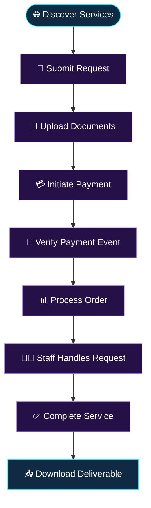
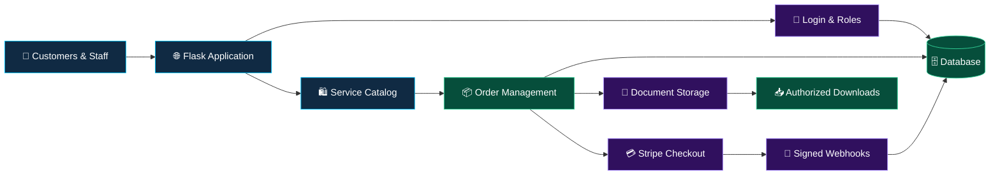

# 🌐 JOHN ONLINE SERVICES & APPLICATIONS

\<div align="center">

\<!-- ANIMATION 01: Animated wave header -->

\

\<!-- ANIMATION 02: Typing brand introduction -->

\

\<br/>

\<!-- ANIMATION 03: Neon divider -->

\

\<br/>


\


\<br/>


\


### 🚀 YOUR DIGITAL WORLD, SIMPLIFIED

**Discover. Request. Upload. Pay. Track. Complete.**

*Connecting people with digital services through a modern, organized, and security-conscious platform.*

[✨ Features](#-features) • [⚙️ Technology](#-technology-stack) • [🚀 Installation](#-installation-guide) • [🔐 Security](#-security-first)

\</div>

---

\<!-- ANIMATION 04: Animated coding GIF -->

\<div align="center">

\

\

\</div>

## 🌌 01. About the Project

**JOHN ONLINE SERVICES & APPLICATIONS** is a Flask-powered digital service marketplace designed to make online services more accessible, convenient, and organized.

The platform supports a customer journey in which users can explore available services, submit orders, upload required documents, pay through supported online payment workflows, follow order progress, and download completed deliverables.

It also provides a role-based foundation for administration, service operations, accounting, and customer access.

### 🎯 Our mission

To simplify digital service delivery by bringing customer requests, documents, payments, and service progress into one organized platform.

\<div align="center">

\<!-- ANIMATION 05: Second typing banner -->

\

\</div>

## ✨ 02. Features & Capabilities

\<table>
\<tr>
\<td width="50%" valign="top">

### 🛍️ Digital Marketplace

\

- Organized service catalog
- Customer service requests
- Order creation and references
- Structured service workflows

\</td>
\<td width="50%" valign="top">

### 📂 Document Management

\

- Customer document uploads
- Local file storage
- Order-related document handling
- Completed-work downloads

\</td>
\</tr>
\<tr>
\<td width="50%" valign="top">

### 💳 Online Payments

\

- Stripe Checkout integration
- Webhook endpoint
- Configurable minimum checkout
- Payment event processing

\</td>
\<td width="50%" valign="top">

### 📊 Order Management

\

- Order status workflows
- Service progress management
- Staff service operations
- Customer order access

\</td>
\</tr>
\<tr>
\<td width="50%" valign="top">

### 👥 Role-Based System

- `super_admin`
- `admin`
- `service_officer`
- `accountant`
- `customer`

\</td>
\<td width="50%" valign="top">

### 🗄️ Database & Forms

- Flask-SQLAlchemy
- Flask-Migrate
- Flask-WTF
- Jinja2 templates
- SQLite development database

\</td>
\</tr>
\</table>

\<div align="center">

\<!-- ANIMATION 06: Animated separator -->

\

\</div>

## 🧭 03. How the Platform Works

\<!-- ANIMATION 07: Workflow diagram -->



\<div align="center">

\

\</div>

## 🧰 04. Technology Stack

\<div align="center">

\<!-- ANIMATION 08: Animated technology icons -->

\

\</div>

| Technology         | Purpose                            |
| ------------------ | ---------------------------------- |
| Python 3.12+       | Core programming language          |
| Flask              | Web application framework          |
| Flask-SQLAlchemy   | Database models and ORM            |
| Flask-Migrate      | Database migrations                |
| Flask-Login        | User session management            |
| Flask-WTF          | Form handling and CSRF integration |
| Jinja2             | Server-rendered templates          |
| Tailwind CSS CDN   | Rapid interface styling            |
| Alpine.js          | Lightweight frontend interactions  |
| Stripe             | Checkout and payment webhooks      |
| SQLite             | Local development database         |
| Local file storage | Uploaded documents                 |

## 🏗️ 05. Architecture



## 💳 06. Stripe Payment Integration

The application includes the following payment endpoints:

```http
POST /orders/<order_number>/stripe-checkout
POST /stripe/webhook
```

### 🇹🇿 Tanzania Shilling configuration

```env
STRIPE_MIN_TZS=1500
```

The application is designed to block checkout attempts below the configured minimum and present a helpful validation message.

**Production requirements:**

- Verify webhook signatures.
- Handle duplicate webhook events safely.
- Validate order amounts on the server.
- Reconcile order payment status using verified events.
- Check Stripe's current currency, account, and payment-method requirements before accepting live payments.

## 🔐 07. Security First

\<div align="center">

\<!-- ANIMATION 09: Security-themed GIF -->

\

\

\</div>

Security recommendations:

- Use a strong, unique application secret.
- Enforce role permissions on the server.
- Protect state-changing forms against CSRF.
- Validate file content, size, type, and storage location.
- Keep private uploads outside public static directories.
- Authorize access to every order and downloaded document.
- Verify Stripe webhook signatures and make event processing idempotent.
- Use HTTPS and secure session-cookie settings.
- Add rate limiting, logging, monitoring, and tested backups.
- Keep dependencies updated and review security advisories.

## 🚀 08. Installation Guide

### Prerequisites

- Python 3.12+
- Git
- Stripe test credentials for payment testing

### Step 1 — Clone the repository

```powershell
git clone https://github.com/johncharlessarwi-dot/REPOSITORY-NAME.git
cd REPOSITORY-NAME
```

Replace `REPOSITORY-NAME` with your actual repository name.

### Step 2 — Create the virtual environment

```powershell
python -m venv .venv
.\.venv\Scripts\Activate.ps1
```

### Step 3 — Install dependencies

```powershell
pip install -r requirements.txt
```

### Step 4 — Configure environment variables

```powershell
Copy-Item .env.example .env
```

Example configuration — use the exact variable names expected by your application:

```env
SECRET_KEY=replace-with-a-long-random-secret
DATABASE_URL=sqlite:///app.db
STRIPE_SECRET_KEY=sk_test_replace_me
STRIPE_WEBHOOK_SECRET=whsec_replace_me
STRIPE_MIN_TZS=1500
```

Never commit real secrets to GitHub.

### Step 5 — Initialize the database

For a new project without an existing migrations directory:

```powershell
flask db init
flask db migrate -m "Initial schema"
flask db upgrade
```

For an existing repository with migrations, skip `flask db init`. Review generated migrations before applying them.

### Step 6 — Seed the application

```powershell
flask seed-data
```

### Step 7 — Create the administrator

```powershell
flask create-admin --name "Super Admin" --email admin@example.com --password "REPLACE_WITH_A_STRONG_PASSWORD"
```

Confirm the CLI command exists in your project. Use a unique password and avoid exposing credentials in shell history.

### Step 8 — Run the application

```powershell
flask run
```

Open:

**[http://localhost:5000](http://localhost:5000)**

## 🎨 09. Visual Experience

\<div align="center">

\<!-- ANIMATION 10: Futuristic gradient banner -->

\

\<!-- ANIMATION 11: Animated product vision -->

\

\</div>

Our design priorities:

- 🌌 Modern, uncluttered layouts
- 📱 Responsive experiences across screen sizes
- ⚡ Efficient customer workflows
- 🔒 Privacy-conscious document handling
- 🧩 Maintainable application architecture
- 🇹🇿 Digital service delivery with Tanzanian users in mind

## 🗺️ 10. Development Roadmap

- [ ] Enhanced customer dashboard
- [ ] Detailed order timeline
- [ ] Email and SMS notifications
- [ ] Advanced administrative analytics
- [ ] Automated payment reconciliation
- [ ] Private cloud document storage
- [ ] Administrative audit trails
- [ ] Automated testing and CI/CD
- [ ] Production deployment automation
- [ ] Swahili and English language support
- [ ] Customer reviews and ratings
- [ ] Expanded financial reports

*Roadmap items are planned improvements, not claims that every feature is already implemented.*

## 📊 11. GitHub Analytics

\<div align="center">

\<!-- ANIMATION 12: GitHub statistics -->

\

\<!-- ANIMATION 13: Language statistics -->

\

\<br/>\<br/>

\<!-- ANIMATION 14: Contribution activity graph -->

\

\<br/>\<br/>

\<!-- ANIMATION 15: GitHub streak -->

\

\<br/>\<br/>

\<!-- ANIMATION 16: GitHub trophies -->

\

\<br/>\<br/>

\<!-- ANIMATION 17: Profile view counter -->

\

\</div>

*GitHub analytics reflect account activity where available; they do not represent customer traffic, marketplace transactions, or live business performance.*

## 🤝 12. Contributing

Ideas, bug reports, and improvements are welcome.

1. Fork the repository.
2. Create a feature branch.
3. Implement and test your changes.
4. Commit with a clear message.
5. Submit a pull request.

```bash
git checkout -b feature/your-feature
git add .
git commit -m "feat: describe your improvement"
git push origin feature/your-feature
```

## 📜 13. License

Add an appropriate license file before distributing this software. Until a license is selected, do not assume that others have permission to reuse or redistribute the code.

---

## 👑 14. Meet the Developer

\<div align="center">

\<!-- ANIMATION 18: Developer branding -->

\

\<br/>

\

### JOHN ONLINE SERVICES & APPLICATIONS

**INNOVATION • TECHNOLOGY • OPPORTUNITY**

*Building practical digital solutions that simplify services and create opportunities.*


\<br/>

\<!-- ANIMATION 19: Animated closing banner -->

\

\

**© JOHN ONLINE SERVICES & APPLICATIONS**

*Designed and developed by JOHN ONLINE SERVICES & APPLICATIONS. &#x20;*

*0698170989/0627310424*

\</div>
